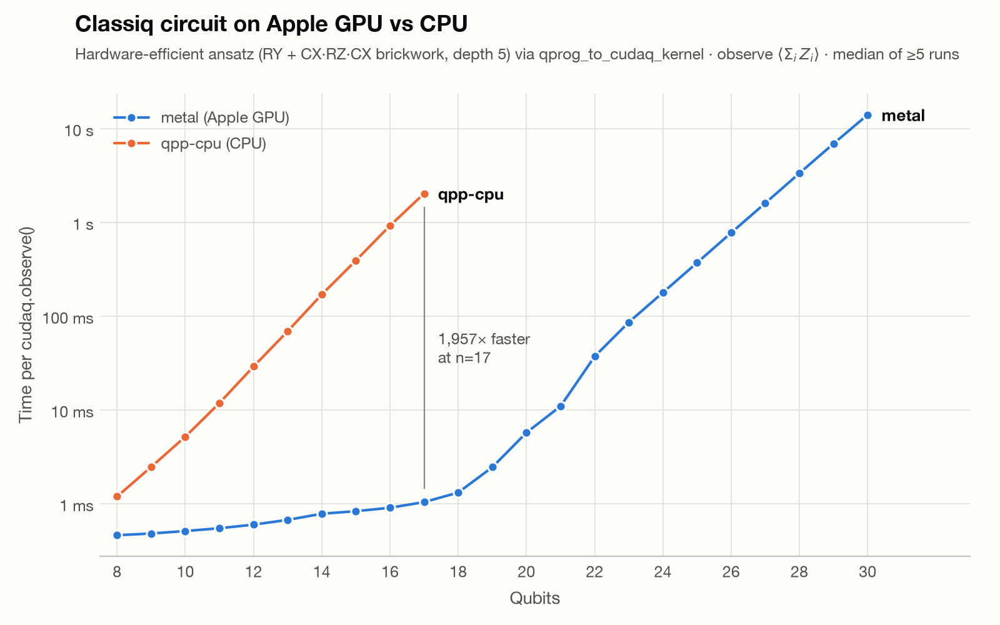

# cudaq-metal — Metal (Apple GPU) backend for NVIDIA CUDA-Q

A naive Apple-Silicon Metal statevector simulator exposed as a CUDA-Q / NVQIR
backend. `import cudaq_metal` and your existing CUDA-Q code runs on the Apple
GPU with `cudaq.set_target("metal")`. No new API, no code restructuring.

> **Unofficial.** This is an independent community project, not affiliated
> with or endorsed by NVIDIA. CUDA-Q is NVIDIA's; this package only plugs a
> Metal simulator into it.

> **🤖 Built entirely with Anthropic's Claude Code.**  
> Every line of C++, Objective-C++, Python, CMake, MSL, tests, benchmarks,
> commits, docs — this file included — was designed and implemented in a
> pair-programming session with Claude. Author-of-record: [@vivanwin](https://github.com/vivanwin);
> co-author on every commit: Claude (Anthropic), see the `Co-Authored-By` trailers.

## Install

```bash
pip install cudaq==0.16.0
pip install https://github.com/vivanwin/cudaq-metal/releases/download/v0.4.0/cudaq_metal-0.4.0-py3-none-macosx_13_0_arm64.whl
```

That installs the wheel attached to the
[0.4.0 release](https://github.com/vivanwin/cudaq-metal/releases/tag/v0.4.0).
To try unreleased changes on `main` instead, use
`pip install git+https://github.com/vivanwin/cudaq-metal.git`.

- **Apple Silicon Mac (arm64), macOS 13 or newer** — the same floor as the
  cudaq wheels. The wheel is tagged `macosx_13_0_arm64`, so pip refuses it on
  Linux, Windows and Intel Macs.
- **Python 3.11–3.14.**
- **CUDA-Q 0.16.x.** The bundled `libnvqir-metal.dylib` is ABI-matched to it
  (the package depends on `cuda-quantum-cu13>=0.16,<0.17`, the binary behind
  `pip install cudaq` on macOS). Pin `cudaq==0.16.0`: the newer
  `cudaq==0.16.0.post1` can't be installed on macOS because it requires a
  `cuda-quantum-cu13==0.16.0.post1` that NVIDIA only published for Linux.
- Optional: Classiq (tested with 1.34) if you build kernels with
  `qprog_to_cudaq_kernel`.

## Use it

```python
import cudaq_metal                       # ← registers the target; import it before cudaq
import cudaq
from cudaq import spin

@cudaq.kernel
def ghz(n: int):
    q = cudaq.qvector(n)
    h(q[0])
    for i in range(n - 1):
        x.ctrl(q[i], q[i + 1])

cudaq.set_target("metal")
print(cudaq.get_state(ghz, 3))                                  # statevector
print(cudaq.observe(ghz, spin.z(0) * spin.z(2), 20).expectation())  # 1.0
```

That's it. `import cudaq_metal` only copies the plugin into your cudaq install
so the `metal` target exists; it doesn't patch anything. From there it's plain
CUDA-Q: `cudaq.sample`, `cudaq.observe`, `cudaq.run` and `cudaq.get_state`
return cudaq's own result objects, for native `@cudaq.kernel` functions and
Classiq-built kernels (`qprog_to_cudaq_kernel`) alike — see
[`examples/`](examples/).

Import `cudaq_metal` **before** `cudaq`: cudaq reads its list of targets once,
at import. If cudaq was imported first, the very first install warns you and
`set_target("metal")` works after a Python restart.

### How `observe` works

Without shots, `cudaq.observe(kernel, H)` hands the whole Hamiltonian to the
backend, as CUDA-Q's `nvidia` target does (`canHandleObserve`). One batched
pass evaluates every Pauli term: no basis-change gates and no separate pass
over the state per term. Large states run it on the GPU (`pauli_expect`:
fp32 partial sums over at most 64 amplitudes per thread, final reduction in
double); small ones run it on the host, on all cores in double, where a GPU
round trip would cost more than the work. Results look exactly as before:
`result.expectation()` and per-term `result.expectation(term)`.

- With `shots_count=...`, CUDA-Q's term-by-term sampling runs instead (it
  needs real samples per term).
- `CUDAQ_OBSERVE_FROM_SAMPLING=1`, CUDA-Q's own switch, turns the batched path
  off for shot-free observe as well.
- `MSV_OBSERVE_DEVICE=gpu` or `host` forces where the batched pass runs
  (default: by state size × term count).

How much it buys depends on the Hamiltonian. For a ZZ-only cost Hamiltonian
(Max-Cut QAOA, 20–40 terms) `observe` is 1.15–2× faster at 16–24 qubits.
Terms with X or Y used to cost two GPU round trips of basis-change gates
each, so mixed Pauli Hamiltonians gain most: 2.6–12× with 8 terms, 30–150×
with 64–2,000 terms (2,000 terms on 12 qubits: 600 ms → 5 ms). GPU and host agree to within 3e-9 up to 30 qubits; `tests/test_observe.py`
checks both against an independent numpy reference and `qpp-cpu`.

### Repeated calls

CUDA-Q builds and frees the statevector on every `sample`, `observe` and
`get_state`, which an optimizer loop does hundreds of times. Two things keep
that per-call cost low:

- **Lazy qubit allocation.** A constant-size register (`cudaq.qvector(20)`,
  or the builder's `qalloc(20)`, which is what every Classiq kernel uses)
  reaches the backend one qubit at a time. The statevector is built once, at
  full size, when the first gate runs, instead of being regrown per qubit.
- **Buffer reuse.** The two most recently freed statevector buffers (17
  qubits and up) are kept, each for the next state of exactly its size, so a
  loop that alternates two sizes also skips allocating and GPU-mapping fresh
  memory; the expectation-value scratch is kept the same way. Idle buffers
  are marked purgeable, so macOS can reclaim them under memory pressure, and
  they are released before a new allocation would exceed the GPU's
  recommended working set, or if one fails. Otherwise they stay in your
  process's memory (8 GiB after a 30-qubit run).
  `MSV_DISABLE_BUFFER_CACHE=1` frees every buffer after each call instead
  (`0`, `false`, `no` and `off` leave reuse on).

Together they cut the fixed cost of a call from 27 to 2.8 ms at 24 qubits
and from 431 to 35 ms at 28 (an almost empty builder kernel). On the
benchmark below that is 5–29% from 17 qubits up (n=30: 15.9 → 14.1 s).

## Examples

Two ready-to-run scaling examples in [`examples/`](examples/):

- [`brickwork_native.py`](examples/brickwork_native.py) — pure CUDA-Q,
  hardware-efficient ansatz (RY layer + CX-RZ-CX brickwork). Runs on `metal`
  by default; set `TARGET = "qpp-cpu"` to compare with the CPU simulator.
- [`brickwork_classiq.py`](examples/brickwork_classiq.py) — **identical
  gate sequence** synthesized through Classiq. Runs on Metal via
  `qprog_to_cudaq_kernel`. Bump `N` upward as you like.

Both are ~30 lines including imports; scale up by changing the `N` and
`DEPTH` constants at the top.

And one full demo:

- [`qaoa_maxcut/qaoa_maxcut.ipynb`](examples/qaoa_maxcut/qaoa_maxcut.ipynb) —
  QAOA Max-Cut on a random 4-regular graph, modelled at a high level in Classiq
  (`phase` of the cut expression inside `repeat`, no hand-written gates) and
  optimized three ways with the same COBYLA loop: Classiq's cloud `minimize`,
  CUDA-Q's `qpp-cpu`, and `metal` (or `nvidia` on an NVIDIA GPU) through the
  batched `observe`. A scaling sweep from 8 qubits up grows each backend until
  one run takes over a minute; the saved results compare an M5 Pro with an
  NVIDIA T4 on Google Colab. Needs Classiq 1.35 or newer.

## Performance

The benchmark runs the `brickwork_classiq.py` circuit — synthesized by
Classiq and converted with `qprog_to_cudaq_kernel` — on CUDA-Q's CPU
simulator (`qpp-cpu`) and on `metal`, timing one
`cudaq.observe(kernel, Σ Zᵢ)` per point; synthesis and kernel construction
happen before the clock starts. Apple M5 Pro (24 GB), CUDA-Q 0.16.0, median
of at least 5 runs (fast points repeat until they add up to 0.5 s):

<picture>
  <source media="(prefers-color-scheme: dark)" srcset="benchmarks/results/examples-dark.png">
  
</picture>

- **qpp-cpu** doubles per qubit, as a CPU statevector does: ~2 s per observe
  at n=17.
- **metal** stays at ~0.5–1.0 ms up to n=17, where the fixed per-call cost
  dominates, and ~6 ms at n=20. From there it doubles per qubit as memory
  bandwidth takes over: ~0.37 s at n=25 (256 MB statevector).
- **At n=17, metal is ~1,960× faster** (2.03 s → 1.04 ms). Metal's
  millisecond-scale times are sensitive to run-to-run noise; earlier runs of
  this benchmark measured 550–1,900×.
- Metal reaches **n=30** (an 8 GiB statevector) in ~14 s per observe;
  extrapolating qpp-cpu's doubling puts it at several hours.
- At 8 qubits there is little to win: ~1.2 ms vs ~0.5 ms.

The frontend doesn't change these numbers: the same gates written as a
native `@cudaq.kernel` (`brickwork_native.py`) simulate at the same speed.

Reproduce with (needs `classiq.authenticate()` once, plus matplotlib for the
plot):

```bash
python benchmarks/examples_scaling_bench.py
python benchmarks/plot_examples.py
```

## What's in the box

| Path | Purpose |
|------|---------|
| `src/metal_sv.{h,mm}` | Metal statevector engine (C-ABI, Objective-C++). One unified-memory MTLBuffer, fast `apply1q` and `apply2q` kernels + general `applykq` up to 4 targets, a `pauli_expect` kernel that evaluates batches of Pauli terms in one pass, lazy command-buffer batching, pipelines compiled once per process, statevector buffer reuse across calls. |
| `src/MetalCircuitSimulator.cpp` | The NVQIR backend: `CircuitSimulatorBase<float>` subclass. Lazy qubit allocation, gate fusion, batched whole-Hamiltonian `observe` (GPU or host), multi-core sampling / measurement over the unified-memory state, zero-copy `get_state`, state initialization, and a tripwire that warns loudly if cudaq ever silently drops a kernel's gates (as CUDA-Q ≤ 0.15 could on Apple Silicon). |
| `scripts/` | Build tooling: `fetch_cudaq_headers.py` (pulls the ~0.7 MB of CUDA-Q headers the plugin needs from the matching source tag), `build_backend.sh`, `refresh_binary.sh` (rebuild + bundle + wheel). |
| `cudaq_metal/` | Python package. Bundles the prebuilt plugin and its CUDA-Q target config (`data/metal.yml`, fp32) and installs both into the active cudaq on import (also available as `cudaq-metal-install`). |
| `tests/` | pytest suite checking `metal` against `qpp-cpu`: every kernel, fusion on/off, sampling, observe, measurement, reset, state init, lazy allocation, buffer reuse on/off, errors. `test_observe.py` checks the batched observe on both GPU and host against an independent numpy reference and qpp-cpu (all Pauli phases, per-term results, shots, chunking, determinism). |
| `benchmarks/` | Scaling benchmark + measured CSV + plot generator, and a fusion A/B benchmark. |
| `examples/` | Small end-to-end examples. |

## Building from source

Only needed when changing the C++/Metal code or moving to a new CUDA-Q
version. Requires Xcode command-line tools and CMake (Ninja optional):

```bash
pip install cudaq==0.16.0
bash scripts/refresh_binary.sh "$(which python)"
```

That reads the CUDA-Q version from the active environment, fetches the
matching C++ headers from the cuda-quantum source tag (the macOS wheel stopped
shipping them in 0.16, and the full toolkit installer is ~630 MB), builds the
plugin against the wheel's own libraries, copies it into `cudaq_metal/data/`
and writes the wheel to `dist/`. For a new CUDA-Q minor version also bump
`COMPATIBLE_CUDAQ` in `cudaq_metal/_install.py` and the `cuda-quantum-cu13`
pin in `pyproject.toml`.

To release, bump `version` in `pyproject.toml` before building, attach the
wheel from `dist/` to a GitHub release for the new tag, and update the wheel
URL under [Install](#install) and in the setup cell of
`examples/qaoa_maxcut/qaoa_maxcut.ipynb`.

To develop against the checkout, install it editable — the next
`import cudaq_metal` copies a freshly refreshed dylib into cudaq — and run the
test suite:

```bash
pip install -e ".[test]"
python -m pytest tests/
```

## Qubit ceiling on your machine

Two limits apply; the lower one wins:

1. **31 qubits, always.** The kernels index amplitudes with 32-bit integers,
   so the engine refuses anything above n=31 (a 16 GiB statevector).
2. **`MTLDevice.maxBufferLength`.** Metal caps a single `MTLBuffer` at
   [`maxBufferLength`](https://developer.apple.com/documentation/metal/mtldevice/2966563-maxbufferlength) —
   a *hard* Metal-API limit, [confirmed by Apple engineers on the developer
   forums](https://developer.apple.com/forums/thread/61188). We hold the
   whole statevector as one contiguous buffer, so it bounds the qubit count.
   It scales with device memory.

Empirically on an **Apple M5 Pro (24 GB unified)**:

- `maxBufferLength` = **14.30 GB** (13.32 GiB)
- `recommendedMaxWorkingSetSize` = 19.07 GB (advisory)
- **n=30 → 8.6 GB buffer → OK** (~14 s per observe, verified on-machine)
- **n=31 → 17.2 GB buffer → fails** with
  `a 31-qubit statevector needs 16.00 GiB, but this GPU's maxBufferLength is 13.32 GiB`

So **n=30 is the ceiling on a 24 GB M5 Pro**; n=31 needs a Mac whose
`maxBufferLength` is at least 16 GiB, i.e. one with more unified memory.
Going past 31 qubits needs a redesigned engine (64-bit indexing and a
statevector split across multiple buffers).

The timing curve stays log-linear right up to the wall (the metal line of
the benchmark above):

| n | statevector | observe |
|---|---|---|
| 25 | 256 MB | 0.37 s |
| 27 | 1 GB | 1.6 s |
| 29 | 4 GB | 6.9 s |
| 30 | 8 GB | 14.1 s |

## Limitations, honestly

- **fp32 statevector only** — Metal has no fp64.
- **At most 31 qubits**, and fewer on smaller Macs (see above).
- **Gates: 1–4 qubit targets** (any number of controls). Anything wider raises
  an error (rare in practice — Classiq's synthesizer produces 1- and 2-qubit
  gates for QAOA/VQE).
- **No noise models** — this is an ideal statevector simulator.
- **Upstream: the list form of observe.** In CUDA-Q 0.16,
  `cudaq.observe(kernel, [H1, H2, ...])` drops term coefficients from each
  total on every backend, `qpp-cpu` included; per-term values are correct.
  Observe each Hamiltonian separately until that is fixed upstream.
- **One CUDA-Q minor version per release.** The plugin is compiled against
  CUDA-Q's C++ internals, so each CUDA-Q minor release needs a rebuild (see
  [Building from source](#building-from-source)).

## License

Apache-2.0 (see [`LICENSE`](LICENSE)).
